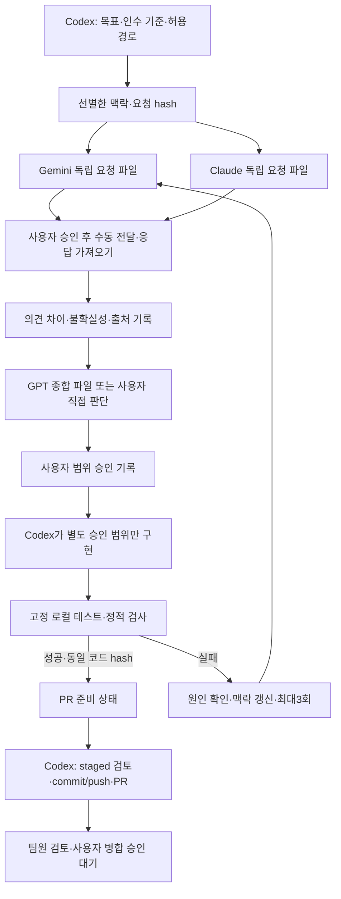

# Notice Me 멀티 AI 개발 절차 — 안전한 파일 기반 초기 버전

2026-11-14. Codex가 계획/구현/검증/PR을 맡고 Gemini·Claude 독립 리뷰와 GPT 또는 사용자 판단을 파일로 연결한다. **이번 구현은 로컬 파일 조정기이며 외부 AI 호출·브라우저 제출·자동 코드 적용·Git 쓰기 기능은 없다.** 기존 서비스/API·차량 앱을 바꾸지 않는다. [공식 지원·비용·현재 환경](AI_INTEGRATION_SUPPORT.md), [MVP 우선순위](GEMINI_REVIEW_REASSESSMENT.md).

## 구조와 실행 경계



외부로 나가는 화살표는 **사람이 별도로 승인·수행하는 전달**이다. 도구가 API나 앱 세션을 연결했다고 읽으면 안 된다. 기존 ChatGPT 웹 채팅과 API Conversations/Codex 스레드는 자동 공유되지 않는다. 모델 의견은 실행할 명령이 아니라 검토할 자료다. GitHub PR 생성은 현재 Codex 작업자가 별도 검증 후 수행하며 CLI는 준비 상태만 표시한다.

## 바로 실행하기

Python3.11+ 표준 라이브러리만으로 파일 기능을 쓴다. 테스트/정적 검사에는 기존 서버 venv의 pytest·Ruff가 필요하다. 아래 python은 그 venv로 실행한다. 전역 PATH/서버 의존성을 변경하지 않는다.

```powershell
# 저장소 루트, 최신 main 기반의 기능 브랜치에서 실행
python -m devtools.ai_workflow init my-task --spec devtools/ai_workflow/example-task.json
python -m devtools.ai_workflow status my-task
python -m devtools.ai_workflow pause my-task
python -m devtools.ai_workflow resume my-task
```

spec에는 goal, acceptance, allowed_paths, context_files를 적는다. 예제는 자동화 도구/문서 범위만 허용한다. 기존 `.env`/DB/키·프로필·차량 코드를 자동 묶음으로 보내지 않는다. 맥락은 명시한 저장소 내부 텍스트만 읽으며 저장소 밖 경로·상위 탐색·보호 경로·민감 내용은 거절한다. 선별한 코드도 사용자 확인 전 외부에 보내지 않는다.

생성된 `.ai-workflow/runs/my-task/`는 gitignore 대상이다.

| 파일 | 의미 |
|---|---|
| packet.json | 첫 목표·인수 기준·선별 맥락 snapshot |
| round-1/gemini-request.json, claude-request.json | 같은 맥락을 가진 독립 요청. 서로의 리뷰는 포함하지 않음 |
| 각 role-review.json | 사용자 수동 import, 모델 출처는 origin_verified=false |
| gpt-request.json | 두 독립 리뷰 후에만 생성. 의견 차이/불확실성은 같은 finding key 기준 비교 |
| user-decision.json | 사용자 판단의 로컬 확인 기록. 실제 사용자 인증/전자서명이 아님 |
| 각 profile-check.json | 로컬 검사 exit code와 제한된 출력. 자동 외부 전송 안 함 |
| events.jsonl | 시각·상태·hash chain·사용량 자기신고·이력. journal이 상태의 기준 |
| packet-round-N.json | retry 시 새로 읽은 선별 맥락. 이전 round 파일 보존 |

## 실제 모델 결과를 가져올 때

이번에는 이 단계를 실제 AI로 실행하지 않았다. [review-template.json](../devtools/ai_workflow/review-template.json)은 NOT_RUN_TEMPLATE이므로 그대로 가져올 수 없다. 승인된 실제 모델 결과만 아래 형식으로 작성한다. 앱/웹에서 어떤 모델로 생성했는지 사람이 확인하며 도구가 독립성·모델/계정 진위를 인증하지는 않는다.

```json
{
  "role": "gemini",
  "iteration": 1,
  "request_hash": "현재 status의 요청 hash",
  "provenance": "MANUAL_MODEL_EXPORT",
  "model_label": "실제로 선택한 모델을 확인한 뒤 입력",
  "verdict": "uncertain",
  "findings": [
    {"key": "routing", "stance": "uncertain", "severity": "major", "claim": "검증할 주장", "evidence": ["확인한 공식 출처 또는 저장소 근거"]}
  ],
  "usage": {"input_tokens": null, "output_tokens": null, "cost_usd": null}
}
```

이는 형식 예시이지 실제 Gemini 리뷰가 아니다. verdict는 approve/changes_requested/uncertain, stance는 support/oppose/uncertain, severity는 blocker/major/minor/info다. 확인할 수 없는 사용량은 null이다. 앱 quota를 API 토큰으로 환산하거나 비용을0으로 채우지 않는다. 직접 편집한 주장/출처의 진위를 검증하는 일은 별도로 필요하다.

```powershell
python -m devtools.ai_workflow import-review my-task --role gemini --file .ai-workflow/gemini-response.json
python -m devtools.ai_workflow import-review my-task --role claude --file .ai-workflow/claude-response.json
# GPT를 실제로 사용했다면 생성된 gpt-request를 승인 후 전달하고 결과 import
python -m devtools.ai_workflow import-review my-task --role gpt --file .ai-workflow/gpt-response.json
```

같은 role 중복·다른 실행/반복/요청 hash·바뀐 요청/packet은 거절한다. source가 수동이므로 명목상 두 파일이 실제 독립 검토였는지는 보증하지 않는다. 키가 다른 비슷한 주장 사이의 의미상 충돌도 자동 판별하지 않는다.

## 판단·승인·실제 검사

[decision-template.json](../devtools/ai_workflow/decision-template.json)은 기본 blocked/미승인이다. 실제 사용자 판단으로 actor=USER, 현재 request_hash와 review_hashes, verdict, synthesis_by(user/gpt), rationale, allowed_paths를 기록한다. gpt를 선택하면 GPT 리뷰가 있어야 한다. 의견 충돌·uncertain·major/blocker의 finding key를 resolved_findings에 근거와 함께 해소해야 하며 비승인 verdict도 verdict-role 키로 설명해야 한다.

이 JSON은 로컬 작업자가 적는 **확인 기록**이다. 파일만 만든 것으로 Codex/플랫폼의 승인, 외부 데이터 전송·유료 사용·보안 권한·main 병합 승인이 생기지 않는다. 승인되지 않은 실제 실행은 별도 사용자 지시 없이 시작하지 않는다.

```powershell
python -m devtools.ai_workflow decide my-task --file .ai-workflow/user-decision.json
# 그다음 Codex가 합의된 범위만 별도로 구현. 가져온 텍스트를 실행하지 않음.
python -m devtools.ai_workflow verify my-task --profile workflow
python -m devtools.ai_workflow verify my-task --profile server
python -m devtools.ai_workflow verify my-task --profile quality
python -m devtools.ai_workflow ready my-task
```

workflow는 unittest, server는 기존 pytest, quality는 Ruff/check·format/check·pip check를 고정된 인자 배열/shell=false로 실행한다. 임의 shell/모델/네트워크 명령은 입력받지 않는다. 사용하는 python은 CLI를 실행한 sys.executable이며 server 테스트 PYTHONPATH를 현재 checkout으로 고정한다. 결과 exit code·코드 fingerprint를 기록하고 실패/timeout/검사 중 변경은 TEST_FAILED다. 세 검사 모두 성공해도 코드가 바뀌면 준비 완료로 보지 않는다. 문서 변경만으로 실행 코드 fingerprint를 바꾸지는 않는다. 문서/비밀값/staged diff 검사는 실제 push 전에 별도로 수행한다.

PR_READY는 commit/push/PR/merge의 실행 결과가 아니다. Codex는 원격·브랜치·범위·비밀값·테스트를 다시 확인하고 기능 브랜치 PR을 열며, main 직접 push/force push/자동 병합을 하지 않는다. 이 초기 버전에는 서비스 기능을 수정하는 executor가 없다.

## 예산·중단·재개

[policy.json](../devtools/ai_workflow/policy.json)의 기본값:

| 한도 | 기본·작동 범위 |
|---|---|
| 반복 | 최대3회. 자동 재귀/상시 반복 없음 |
| 외부 호출·브라우저 입력 | 0회, transport 미구현. 설정만 true로 바꾸면 거절 |
| 리뷰 import | 실행 전체 최대9회. 수동 앱 제출 횟수/실제 모델 호출 수를 계측한다는 뜻은 아님 |
| 요청/응답 파일 | 각48,000byte. byte를 정확한 토큰 수라고 표시하지 않음 |
| 보고된 토큰 | 누적60,000. 자기신고/unknown은 실제 사용량 상한 보장 아님 |
| 보고된 비용 | $0.00. 알려진 양수 비용 import는 BUDGET_STOP, 미확인 비용은 unknown 개수로 기록 |
| 로컬 검사 | profile당/round당1회. 120초 직접 프로세스 timeout, 실패 시 새 round 필요 |

```powershell
# 실패/수정 요청 후 명시적으로 다음 반복. 이전 맥락 파일은 다시 읽음
python -m devtools.ai_workflow retry my-task --context docs/AI_REVIEW_CONTEXT.md
```

추가 context는 내용을 선별/민감 검사한 로컬 snapshot이며 자동 모델 전송이 아니다. context/scope를 바꿔 이전 리뷰를 재사용하지 않는다. 3회 초과는 사용자 연장 확인 파일(actor,현재 request_hash,new_iteration_limit,rationale)이 필요하며 `--extension`으로 기록한다. 리뷰 제출 상한도 늘려야 한다면 new_review_import_limit를 명시한다. 연장만으로 비용/토큰/외부 권한을 확대하지 않는다. 정책 파일의 max_iterations를3보다 크게 바꿔 새 실행을 만드는 방식도 거절한다.

401/403/429·quota/결제·권한 오류 시 후속 adapter는 중단해야 하며 자동 재시도 기본0을 권고한다. timeout은 과금0을 뜻하지 않아 공급자 사용량을 확인하기 전 재전송하면 안 된다. 현재 파일 도구에는 그러한 호출 자체가 없다. BUDGET_STOP·불명확한 권한/데이터 반출·변경된 기준 브랜치·journal 손상은 자동 복구/무한 재시도 대상이 아니다.

pause/resume는 명령 사이의 journal checkpoint를 유지한다. 이미 실행 중인 검사를 즉시 취소하는 기능은 아니며 직접 프로세스 timeout 또는 사용자의 터미널 중단과 구별한다. 쓰기 lock으로 중복 실행을 막으며 오래된 lock을 자동 삭제하지 않는다. 충돌/부분 기록·디스크 오류·손상은 멈추고 증거를 보존한다. hash chain은 손상 감지용이고 로컬 사용자의 위조까지 방지하는 인증 수단은 아니다. subprocess timeout이 모든 손자 프로세스/네트워크 비용을 강제 제한하는 OS sandbox는 아니므로 후속 완전 자동화에는 별도 격리가 필요하다.

## 후속 외부 연결의 승인 조건

모델별 계정/정확한 model ID·요금/무료 혜택·잔액·목적과 반출 권한을 확인한 뒤, **대상 공급자/세션, 보낼 실제 packet hash, 최대 호출/입출력·생각 토큰, 비용/크레딧, timeout/재시도0, 승인 만료/취소**가 담긴 구체 실행안을 사용자에게 먼저 제시해야 한다. 학교 BAZE 문서가 없으면 adapter를 만들지 않는다. 실제 금액을 모르는 상태를0원으로 간주하지 않는다.

다음 구현 순서는 공식 CLI/SDK 준비 상태 확인 → 한 공급자의 읽기 전용 리뷰1건 승인 → 성공/오류/usage 정규화 → 두 독립 리뷰 → GPT 종합/사용자 판단 → 제한된 구현 실행이다. 처음부터 SDK 네 종류·브라우저 스케줄러·자가 수정/재귀 agent를 한 번에 연결하지 않는다. 현재는 실제 모델 호출/웹 입력 승인 요청 전 단계에 머문다.
