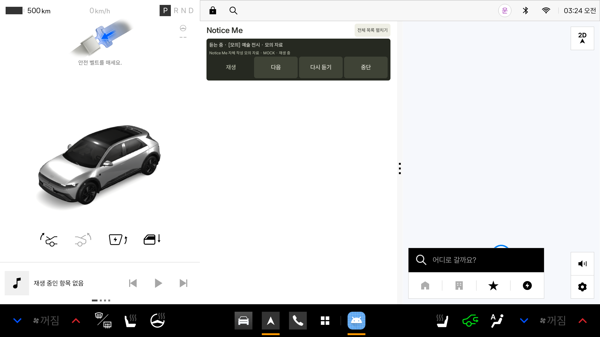
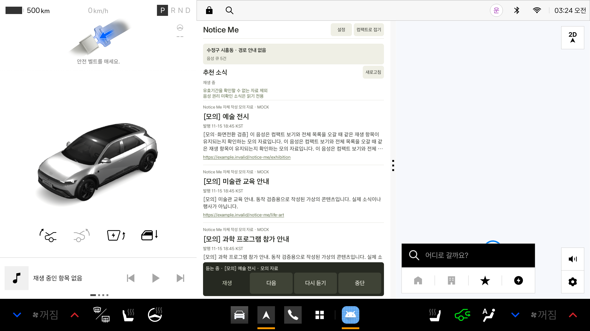

# 컴팩트 UI 별도 시안 — 제출본 아님

## 기준과 구현

별도 worktree/feat/vehicle-compact-preview는 main09b106b(PR #13 UI)에서 시작했다. source **9a1cb9de82ebcae24efb1ef6b8dc90644d58dfb8**, 앱 **0.3.7-compact-preview/code13**. 이후 사용자가 요청한 최신 팀원 PR #16은 release 검증 브랜치에 별도로 반영하며 **이 실험에 섞지 않았다**. 팀원의 로컬·원격 브랜치/기존 APK를 덮어쓰지 않았다.

MainActivity에 compact/detail 표시만 추가했다. compact는 Notice Me·현재 소식1개·출처/상태1줄·4개 제어·전체 목록 펼치기, detail은 기존 TOP3·brief/원문·설정·음성 큐 개수를 표시한다. 한 Activity의 같은 FeedController·DeviceSpeechPlayer·버튼 객체를 유지하고 visibility/maxLines만 바꾼다. 모드 전환에서 connect/stop/recreate/window resize를 호출하지 않는다. 처음은 연결 설정이 가능한 detail이며 사용자가 접을 수 있다.

API·서버·권리/만료·TTS SDK·onStop 중단 정책은 그대로다. 앱이 화면에서 사라져도 계속 읽는 기능이나 오버레이/더 좁은 시스템 창을 구현한 것은 아니다. rotation/시스템 창 전환에 따른 Activity 재구성까지 상태를 영구 보존하는 기능은 이 시안에 없다.

## 실제 검증

- 두 flavor release assemble PASS. 실제 제공되는 debug unit test 각26/실패0/skip0, 로컬 MOCK HTTP 포함. Release Lint 오류0, 기존 경고 Pleos10/standard4.
- 같은 공모전 키로 release 서명·apksigner v3/zipalign 검사·새 UI AVD에 같은 패키지/code13으로 update 설치 성공. 서명 충돌/데이터 삭제 없음.
- 기본 내비와 나란히 있는841dp 창에서 실제 MOCK HTTP 콘텐츠를 재생하며 detail→compact→detail 전환. 세 화면 모두 같은 [모의] 예술 전시가 듣는 중이고 controller identity가 동일했다. 마지막 토글 시점까지 SDK speak는1회로, 모드 전환이 발화를 재시작하지 않았다. onDone 관측, onError0, SDK 텍스트는 실제 HTTP detail과 일치했다. [기계 판독 기록](verification/2026-11-15-compact/result.json).
- compact 모드 안에서 재생·다음·다시 듣기·중단도 실제 재검증했다. 다음은 다른 항목으로, 다시 듣기는 같은 항목으로, 중단은 재생 false로 전환됐다.
- 중간 UI 자동화는 활성 창이 내비여서 버튼을 찾지 못했다. 실제 캡처에서 Notice Me가 보이는 것과 접근성 root가 활성 앱인 것은 달랐다. Notice Me를 터치해 focus를 확인한 뒤 재실행했다. 앱 crash로 오인하거나 테스트 성공으로 처리하지 않았다.
- 충분한 재생 시간을 확보하려고 task-owned MOCK SQLite의 brief1건에 명시적 [모의·화면전환 검증] 자체 문장을 잠시 넣었다. 실제 뉴스/행사를 생성한 것이 아니며 원본DB/소스/수집기는 바꾸지 않는다. 검증 후 fixture를 복원한다. 개인정보·위치/목적지 이력·단말 로그는 커밋하지 않는다.

|컴팩트 모드|동일 항목을 재생하는 상세 모드|
|---|---|
|||

## 시스템 창과 제출 판단

[공식 Window Policy](https://document.pleos.ai/en/docs/connect/guide/docs-design/getting-started/window)와 [앱 구조](https://document.pleos.ai/en/docs/pleos-only/vehicle-app-planning-guide/app-structure-screen-model)의 시스템 분할을 이용했다.1682dp에서841dp portrait slot 전환은 실제 확인했고, Window bar를 native drag해 시스템 전환을 재현했다. Driving view는 고정 영역이며 compact 표시가 그 공간이나 시스템 창의 실제 폭을 더 줄여 주지는 않는다.841dp 미만 임의 띠형 창/다른 앱 위 그리기는 공식 지원 근거 없이 적용하지 않았다.400dp 미만·글자 확대·실차·배경 재생은 미검증이다.

**이 시안은 최신 PR #16 스타일을 포함하지 않고 제출에 권장하지 않는다.** PR #16과 MainActivity 및 누적 기록에서 merge-tree 사전 비교에서 MainActivity/누적 기록3파일의 충돌을 확인했으므로 사용자/팀원 검토 전 병합 금지다. 서버/FeedController의 동일 상태를 유지하는 최소 시도로만 검토하고, 최종 UI가 확정되면 별도 합의 후 포팅·재검증한다. APK는 로컬 실험 산출물로 보관하고 제출용 apk/에는 추가하지 않았다. main/PR #15/저장소 공개/신청서/메일은 변경하지 않았다.
