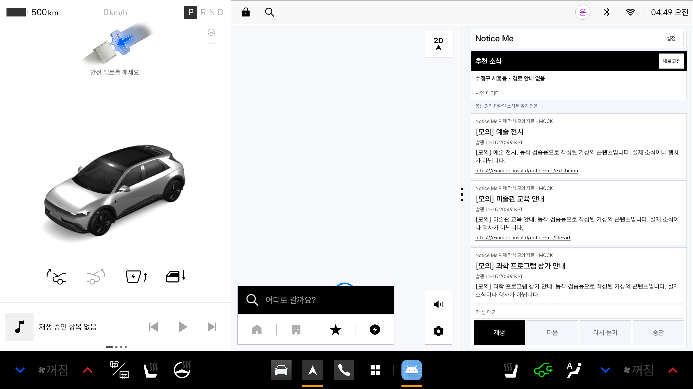
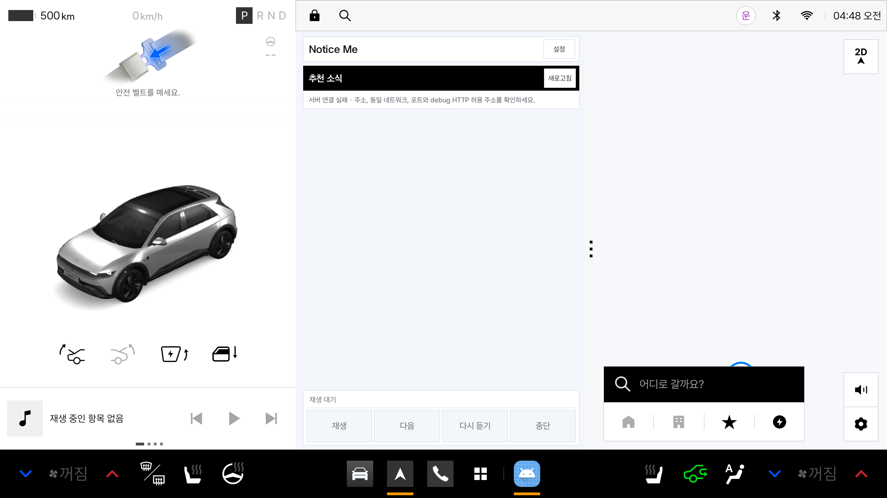

# Notice Me 2026년 11월 15일 최종 제출 검증

2026-11-15 KST에 별도 `feat/vehicle-final-submission`에서 0.3.7/code13을 구성하고 다시 검증했다. 신규 서비스 기능은 추가하지 않았다. main 병합·Public 전환·접수 메일 발송은 수행하지 않았다. 아래는 이번 실행 결과이며 과거 청취 기록을 현재 결과로 복사하지 않았다.

## 소스와 APK 기준

|역할|기준|
|---|---|
|시작 main|`09b106b65e8bf71f033be273d25ac655f40b5b33`|
|선택 UI / PR #16|`6cdd8e3164f6d62929811a758a5686665913e07e`|
|검증된 기존 APK의 원래 빌드 입력|`024d1b28f8b6649d20339266349e256933636d46`|
|이번 최종 구성의 코드 검증 입력|`f5f194a73036c4540f2b756ac6fa439998f4659d`|
|최종 접수 기준|이 보고서와 APK를 포함한 최종 PR head 전체 SHA. `git rev-parse HEAD` 및 원격 PR head로 확인하여 접수 메일에 기재|

PR #16 head를 새 기능 브랜치에 fast-forward로 포함하고 PR #17의 release HTTP 설정·동일 APK만 선별했다. PR #14의 1차 접수/서버 한계/검증 구분은 재작성한 README에 반영했다. PR #14~#18을 일괄 merge하지 않았다. PR #15의 0.3.3 APK·PR #18 compact·PR #11 자동화는 최종 소스와 그 새 ancestry에 추가하지 않았다. 다른 원격 브랜치/PR 자체는 삭제하지 않았으므로 저장소 공개 시 과거 작업도 보인다는 점은 [공개 감사](PUBLICATION_AUDIT_2026-11-15.md)에 구별한다.

공식 APK는 **[apk/울산동천고듀오_NoticeMe_release.apk](../apk/울산동천고듀오_NoticeMe_release.apk)** 하나다. 크기 **24,951,759 bytes**, SHA256 **`2a072c6b6f56e1025e7e7f40dc16aea85c98b351df32ce786a50c4ce29b73211`**. 원래 검증 해시와 일치하므로 재서명/교체하지 않았다. `.gitignore` 추적 예외도 이 파일 하나다. 기존 로컬 debug/release APK·AVD·키는 보존했다.

새 worktree에서 두 release flavor를 실제 재빌드했다. 위 원래 빌드 입력과 최종 코드의 Android 빌드 관련 파일 차이는 0이다. 새 unsigned Pleos APK와 제출 signed APK의 **공통 ZIP entry 전부의 바이트가 일치**한다. 제출 APK에만 서명용 META-INF 3개가 더 있다. dex/manifest/resources만 일부 비교한 결과로 확대 주장한 것이 아니다. 따라서 최종 소스와 기존 검증 APK가 같은 구현임을 확인하면서 기존 서명·해시를 보존했다. [비교 결과](verification/2026-11-15-final/apk-core-comparison.safe.json).

## 이번에 실제 실행한 검증

|검사|실측 결과|
|---|---|
|새 Python3.11.9 venv + README 설치 명령|requirements.lock 설치, editable --no-deps 성공. 기존 venv/.env/DB 미변경|
|pytest|190 passed / 실패0 / 건너뜀0. 실행 시 warning1개는 성공 수치와 별도|
|Ruff / format / pip check|PASS / 38 files formatted / broken requirements 없음|
|Pleos·Standard release 빌드|둘 다 성공. 빌드 task 출력은 unsigned이며 제출 파일과 구별|
|JVM 단위·HTTP 계약 테스트|각 flavor 26 tests / 실패0 / skipped0. `NOTICE_TEST_BASE_URL`로 이번 MOCK 서버 health/feed/detail 실제 요청 포함|
|Release Lint|Pleos 오류0·경고8, Standard 오류0·경고4|
|서명 / zipalign / 설치|v3·RSA3072·signer1 검증, alignment 통과. 같은 서명으로 `adb install -r` 성공, 삭제/데이터 초기화 없음|
|실제 설치 버전|`ai.noticeme.vehicle`, 0.3.7/code13, min28/target34, debuggable 아님|
|MOCK HTTP|health/feed/detail/explain200, 오류404/422, 미허가 뉴스 explain403, OpenAPI typed responses 확인|
|TOP3·음성 큐|내비 없음 기준 TOP3 3 / queue5 / alerts0, 권리·만료·중복·playback_order 검증|
|Pleos TTS|ON_DEVICE SDK doSpeak의 모든 문장과 서버 detail.brief 일치. onDone 로그 확인. 실제 사용자 한국어 청취 재확인|
|재생·다음·다시 듣기·중단|실제 버튼/상태 검증. 다음은 다른 항목, 다시 듣기는 동일 항목, 중단은 재생 상태 해제|
|분할 화면|기본 내비 가운데·Notice Me 오른쪽 동시 표시. 시스템 창 바의 drag/tap만 사용|
|서버 미연결·복구|이번 서버만 종료 후 refresh: 오류 표시·기존 카드 제거·재생4버튼 비활성. 서버 재시작 후 health200·카드 복구|

[실행 요약 JSON](verification/2026-11-15-final/final-validation.safe.json), [HTTP](verification/2026-11-15-final/mock-http.safe.json), [TTS](verification/2026-11-15-final/tts-final.safe.json). 원본 단말 로그와 테스트 XML의 개인 PC 식별자는 업로드하지 않았다. onDone 로그 수는 SDK 중복 로그를 포함할 수 있어 독립 발화 횟수로 계산하지 않는다.

Lint 경고는 target34 최신성, Gson 버전, JNA x86_64 16KB alignment, backup extraction rule, 앱 아이콘, KTX 사용 권고다. API34 에뮬레이터의 이번 성공이 향후16KB 기기/Market/실차 안전성 보장을 의미하지 않는다. 제출 직전 의존성·UI를 바꾸는 리팩터링은 하지 않았다.

검증 환경: Windows11, Android Studio JBR25, 프로젝트 Gradle wrapper9.6.0/AGP9.5.1, SDK Platform37/Build Tools36.0.0. 실행은 **Pleos Connect2.1/API34/x86_64,2560×1440px/160dpi**, 분할 앱 영역 각841×1210px. AVD 시계 표시와 실제 검증 KST는 다를 수 있어 JSON UTC 시각을 기준으로 한다.

## 실행 방법과 한계

[README](../README.md)의 PowerShell 절차를 새 worktree에서 재현했다. 새 DB를 저장소 밖에 만들고 이번에는 기존8000/8001 서버를 보호하기 위해 **8002**를 사용했다. 앱의 주소도 `http://10.0.2.2:8002`로 실제 변경·확인했다. localhost health 확인→앱 refresh→TOP3→detail/SDK 문장 대조→버튼 제어→서버 미연결/복구 순서다.

MOCK는 FastAPI가 제공하는 자체 가상 정보이며 APK 단독 오프라인 데모가 아니다. 공용 서버 미배포 상태에서 외부 심사자는 별도 서버를 실행하고 앱 주소를 설정해야 한다. HTTP 평문은 release에서도 emulator/loopback 3호스트만 허용한다. 앱의 연결 실패 문구에 남은 “debug HTTP” 표기는 이번 release의 제한된 허용 설정을 정확히 표현하지 못하는 기존 문구다. UI/해시 보존을 위해 수정하지 않았고 실제 적용 정책은 README에 명시했다.

기존0.3.3에서 실제 서울시 고정 지역 날씨 brief와 Pleos 청취를 검증한 이력은 [기존 기록](verification/2026-11-13-live-weather-vehicle.md)이다. **이번 최종0.3.7 실행은 MOCK이며 최신 LIVE 날씨를 다시 수집·재생하지 않았다.** 콘텐츠 제공자·라우팅·외부 AI 실제 호출은 모두0회다. 뉴스 본문·권리 미확인 TourAPI Type3 음성·검증 이동시간 없는 LIVE 행사 추천 차단을 유지한다. 내비 경로 조회와 목적지 생성은 구분하며 실제 경로 주행/행사 이동시간은 이번에 검증하지 않았다.

실차, 주행 중 안전성,400dp 미만/글자 확대 전체 조합, 최신 LIVE 날씨, 잡음 개선, Market 등록은 미검증 또는 후속이다. STT/Gleo/학교 AI/새 뉴스·팝업 수집/길찾기/관심사 OR API/클라우드 배포는 미구현이며 추가하지 않았다.

## 병합과 접수

추천은 **이 최종 PR 하나를 검토 후 승인하여 병합**하는 방식이다. PR #16 UI commit이 ancestry에 있으므로 #16을 별도로 먼저 합칠 필요는 없다. #14/#15/#17을 다시 합치면 중복 문서와 이전 APK/preview 경로가 들어갈 수 있다. #18은 제외한다. 기존 PR을 닫거나 병합하는 작업도 사용자의 결정 전 실행하지 않는다.

최종 PR head는 main 미병합 상태에서도 소스와 APK를 포함한 독립 제출 commit이다. 접수 메일에는 브랜치명만 적지 말고 저장소 URL과 **최종 전체 SHA**를 적는다. 이후 squash/merge로 main commit이 바뀌면 실제 채택한 기준을 다시 확인한다. 원래 APK build commit을 최종 제출 commit으로 잘못 적지 않는다.

[공식 제출 안내](https://appdevchallenge.auto-hmg.io/guide/submission)와 [FAQ](https://appdevchallenge.auto-hmg.io/faq)는11/15 23:59 접수, 소스+APK, README 환경/경로, private 제출 후11/16까지 public·11/23까지 유지를 안내한다. 신청서·각 팀원 동의/서명/날짜·CC·메일 발송은 사용자 작업이다. 첨부 신청서 원본은 읽기 전용으로 확인했고 수정·업로드하지 않았다. 공개는 [보안 감사 조건](PUBLICATION_AUDIT_2026-11-15.md)을 사용자가 검토하고 별도 승인한 뒤 수행한다.
