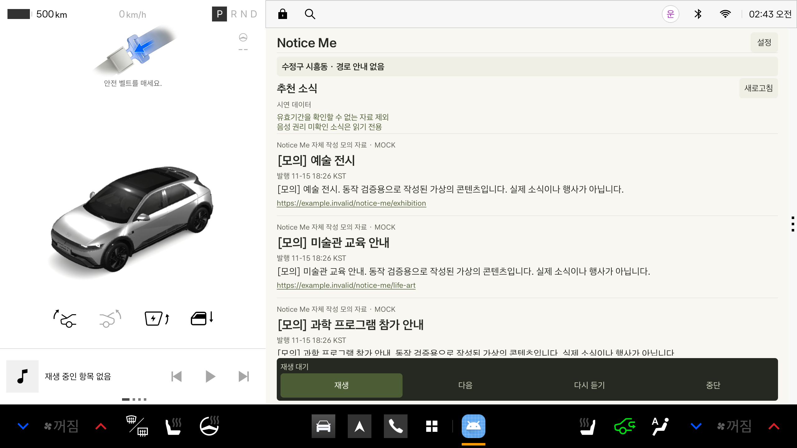
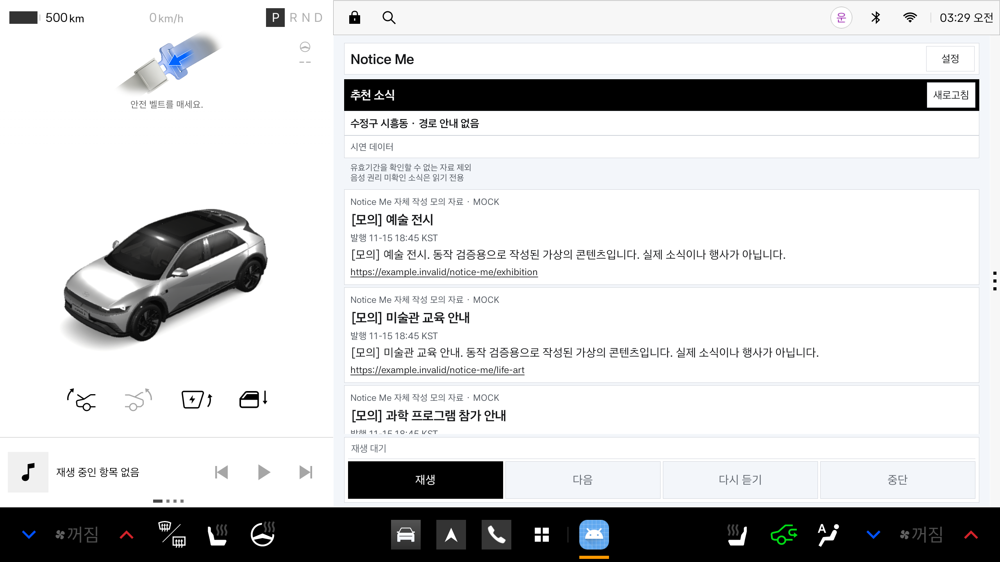

# PR #16 팀원 UI + release 통합 검증 — 2026-11-15

## 현재 검토 후보

사용자가 작업 중 팀원이 새 UI PR을 올렸다고 알려 반영을 지시했다. 원격을 다시 fetch하고 [PR #16](https://github.com/Notice-Me/notice-me/pull/16)의 **6cdd8e3164f6d62929811a758a5686665913e07e**를 확인했다. main09b106b 기반 **feat/vehicle-release-ui-preview**에만 팀원 브랜치를 병합했다. main/팀원 원격 브랜치에는 push/merge하지 않았다. 충돌은 누적 기록3개에서만 발생해 양쪽 기록을 모두 남겼고, MainActivity는 팀원 commit과 byte-identical임을 diff로 확인했다. 이전 [PR #13 UI 검증본](RELEASE_UI_PREVIEW_2026-11-15.md)과0.3.3 안정 APK는 보존한다.

- 앱 **0.3.7 / code13 / pleosRelease / debuggable=false**
- 빌드 입력 **024d1b28f8b6649d20339266349e256933636d46**. 이후 APK/기록을 추가한 최종 PR commit과 구분한다.
- [APK](../apk/preview/NoticeMe-0.3.7-pr16-pleos-release.apk), **24,951,759bytes**
- SHA256 **2a072c6b6f56e1025e7e7f40dc16aea85c98b351df32ce786a50c4ce29b73211**
- [기계 판독 결과](../apk/preview/manifest-pr16.json). 기존 공모전 인증서 SHA256 e0bbf1e148be28c9047c1ee1a9360218fae113d7f0fba824766ccb263ec8752e를 재사용했다. 개인 키/비밀번호는 저장소 밖·임시 환경변수로만 사용하고 출력/업로드하지 않았다.
- 같은 키/code13으로 테스트 AVD에 update 설치 성공. uninstall/pm clear/AVD 삭제/기존 앱 데이터 삭제 없음. 설치 APK를 다시 읽어 로컬 후보 SHA와 일치함을 확인했다.

## 실제 검증과 범위

|항목|이번 PR #16 release|
|---|---|
|서버|코드 변경 없음. main09b106b 소스로 pytest190, Ruff/format39/pip check 통과|
|빌드/테스트|두 flavor release assemble, 각 flavor 실제 debug unit26/실패0/skip0/로컬 MOCK HTTP 포함. UI 변경 후 다시 실행|
|Release Lint|오류0, 기존 경고 Pleos10/standard4. native16KB/targetSdk 등의 해결이나 Market 승인을 의미하지 않음|
|서명/설치|apksigner v3 verify·zipalign PASS, 새 UI 전용 Pleos Connect2.1/API34/x86_64 AVD 설치·실행|
|서버→UI→SDK|실제 로컬 MOCK health/feed/detail HTTP200, TOP3 표시. SDK ON_DEVICE 발화8건 모두 실제 HTTP detail.brief와 일치, onDone 로그10건/onError0. 콜백 로그 수는 독립 음성 건수가 아님|
|재생 제어|재생 중/다른 항목 다음/동일 항목 다시/중단 상태를 실제 UI로 재검증|
|사람 청취|이전0.3.7 UI 청취와 구분해 최신 흑백 PR #16 release를 다시 재생. 사용자가 “한국어 음성이 들림”, “잘들려”로 확인|
|화면|841dp 창에서2줄 제목 END 말줄임. 마지막 원문 링크 하단1106px < 고정 player 상단1128px, 스크롤 접근 확인|
|외부 호출|이번 콘텐츠/외부AI/라우팅 provider0. 기본 내비/SDK 내부 네트워크는 미계측|
|미검증|이 APK의 LIVE 날씨 재생·실차/주행·400dp 미만/글자 확대 전체 조합·백그라운드 지속 재생|

검증에는 별도 task-owned MOCK DB/서버8001을 썼다. 긴 제목과 모드 전환용 긴 brief는 명시적 자체 모의 문장으로 잠시 변경 후 원래 fixture로 복원했다. 원본.env/DB/키/개인 설정/팀원 로컬 파일/서버 수집·권리·추천 계약은 변경하지 않았다. 기존0.3.3 APK hash7aa31e6b81220bac2ae76c6e86db670ac3d5b9ab06bbe2a622a1ba3aa54cb78d 및 별도 backup 동일성을 재확인했고 기존 개발/안정 release AVD를 삭제하지 않았다. 단말 로그·UI XML·정밀 위치/목적지 이력은 커밋하지 않았다.

## 실제 화면과 창 배치

|기존 안정0.3.3|최신 PR #16 UI|
|---|---|
|||

[841dp 분할](verification/2026-11-15-ui-pr16/split.png) · [긴 제목](verification/2026-11-15-ui-pr16/long-title.png) · [마지막 카드/플레이어](verification/2026-11-15-ui-pr16/scroll-bottom.png).

[공식 Window Policy](https://document.pleos.ai/en/docs/connect/guide/docs-design/getting-started/window)와 [앱 구조](https://document.pleos.ai/en/docs/pleos-only/vehicle-app-planning-guide/app-structure-screen-model)를 확인했다. 차량/화면별 차이를 무시해 전체 디스플레이를 자유 비율로 줄일 수 있다고 판단하지 않는다. Driving view는 고정 영역이며 앱 영역에 최대2개 창을 표시한다.

처음 사용자가 직접 분할해 검증을 도왔고, 이후 **창 바 native drag**로1682dp→841dp 분할을 재현했다. 단순 tap/long-press 시도만으로 크기가 바뀌었다고 기록하지 않았다. 두 앱 사이 창 바 tap은 위치 교환에 성공했다. 사용자 요청대로 최종 **가운데 내비(853,90)-(1694,1300), 오른쪽 Notice Me(1718,90)-(2559,1300)**를 실제 확인했다. 각각841×1210px/160dpi다. [최종 가운데 내비 배치](verification/2026-11-15-ui-pr16/nav-center.png).

이는 앱이 임의로 다른 앱 위치/폭을 강제한다는 뜻이 아니다.841dp보다 더 얇은 자유 폭/overlay/Driving view 숨김은 지원 근거 없이 적용하지 않았다. 코드의 windowWidth<400 분기는 있으나 해당 크기의 실제 테스트는 아니다. 시스템 창 크기 전환에서 Activity가 새로 구성되어 새로고침 대기가 된 기존 동작도 관측했다. onStop TTS 중단 정책을 보존해 최소화 후 음성 계속 재생을 보장하지 않는다.

## 컴팩트 시안과 채택

[별도 compact 시안 PR #18](https://github.com/Notice-Me/notice-me/pull/18)은 PR #13 기준의 독립 실험이며 PR #16 UI를 덮어쓰지 않았다. 같은 controller/current로 detail↔compact 토글·발화 재시작 없음/compact 안4개 제어를 실제 확인했다. 시스템 폭을 줄이는 구현이 아니다. PR #16과 MainActivity/기록3파일의 충돌을 사전 확인했으므로 검토 전 함께 병합하지 않는다.

최종 제출 UI 후보로는 **최신 팀원 PR #16을 포함한 이 release를 우선 검토**하되 사용자가 채택하기 전 기존0.3.3 제출 파일을 교체하지 않는다. 권장 검토 순서는 PR #16 UI → PR #17 release 산출물이며, PR #18은 독립 DRAFT다. PR #15의0.3.3 APK/문서를 최신0.3.7이라고 재사용하지 않는다. main 병합/자동 병합·Public 전환·신청서 수정·메일 발송은 하지 않았다. 새 팀원 commit이 생기면 이 pin의 검증을 새 commit 검증으로 확장해 주장하지 않는다.
