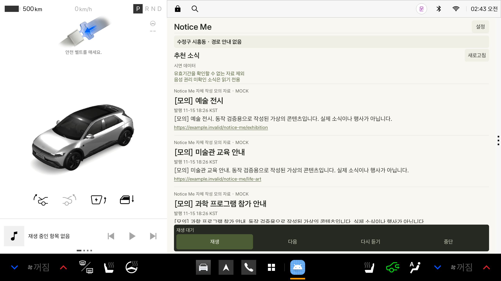
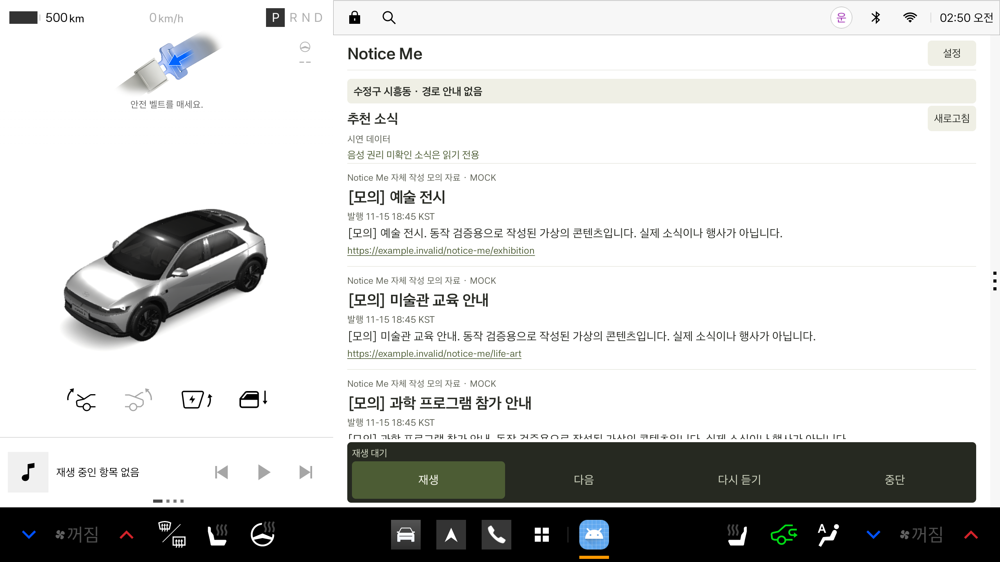

# 0.3.7 팀원 UI release 통합 검증 — 2026-11-15

## 기준과 범위

origin/main **09b106b65e8bf71f033be273d25ac655f40b5b33**(PR #13 병합)의 Kotlin·UI XML·스타일·서버는 수정하지 않았다. 별도 worktree의 feat/vehicle-release-ui-preview에서 PR #15의 release 전용 HTTP allowlist(10.0.2.2/localhost/127.0.0.1)와 키 제외 규칙만 선별했다. PR #15를 통째로 병합하거나 0.3.3 APK를 재사용하지 않았다. 새 APK 빌드 소스는 **fa375618db99e78980c36091ba7432b362328c67**이다. 이후 문서/APK 추가 commit과 구별한다.

[새 APK](../apk/preview/NoticeMe-0.3.7-pleos-release.apk)는 **0.3.7/code13, 24,951,759bytes**, SHA256 **e45a930c37534bd09c6a22975e0b9f356e44626b9b06ea5ea235c5f07bda7ead**. [기계 판독 결과](../apk/preview/manifest-0.3.7.json). 독립 공모전 키를 저장소 밖에서 재사용했으며 공개 인증서 SHA256은 e0bbf1e148be28c9047c1ee1a9360218fae113d7f0fba824766ccb263ec8752e로 기존0.3.3과 같다. 개인키/암호는 APK/Git/로그에 넣지 않았다. apksigner v3 verify와 zipalign 검사 통과, debuggable 비활성, 신규 UI 전용 AVD 설치 성공. 기존 앱 데이터 삭제/기존 AVD 삭제 없음.

## 실제 실행

- 서버 pytest190, Ruff/format39/pip check 통과. 두 flavor release assemble 성공, 각각 실제 제공되는 debug unit test26/실패0/skip0(로컬 MOCK HTTP 포함). Release unit task가 제공된다는 뜻은 아니다.
- Release Lint Pleos 오류0/경고10, standard 오류0/경고4. 기존 native16KB·targetSdk 등 경고는 해결하지 않았다. SDK/의존성은 기존 cache를 offline 사용했다.
- 새 Pleos Connect2.1/API34/x86_64 AVD에서 서버 health/feed/detail HTTP200과 TOP3 표시, 재생/다음/동일항목 다시/중단 상태를 검증했다. SDK ON_DEVICE 발화8건 모두 실제 HTTP detail의 brief와 일치하고 onDone 로그10건, onError0. 콜백 로그 수를 독립 음성 건수로 해석하지 않는다. 사용자가 이번0.3.7 release에서 **한국어 음성이 들림**을 확인했다. 위 SDK8건/onDone10은 최초 wide 재생 확인 시점이며 이후841dp에서4개 제어를 추가 재검증했다.
- 처음 detail 비교는 화면3건만 대상으로 해 큐의 다른 소식을 누락했다. 허용된 MOCK 큐5건의 실제 detail까지 비교 범위를 바로잡아 전체 일치를 확인했다. 앱 구현 변경으로 해결한 문제가 아니다.
- 별도 task-owned MOCK SQLite/서버8001을 사용했다. 설정 입력 중 Pleos 전체 화면 IME가 원래 앱의 accessibility tree를 남겨 다른 필드에 입력됐고, 키보드를 닫고 focus 확인 후 서버/관심사 값을 바로잡았다. 원본.env/DB/개인 설정과 서버 로직은 수정하지 않았다.
- 긴 제목은 이 task의 MOCK DB 한 항목만 명시적 [모의·UI검증] 문구로 변경해 검증하고 복원했다. 실제 행사 생성/수집이 아니다. 긴 제목2줄 END 말줄임, 하단 플레이어 정렬, 스크롤 후 마지막 카드 원문 링크 하단1104px가 플레이어 상단1133px보다 위에 있는 것을 확인했다.
- 이번 실행의 콘텐츠 제공자/외부AI/외부 라우팅 호출0. 기본 내비/SDK 내부 네트워크는 계측하지 않았다. LIVE 날씨·실차·정차 안전성·모든 폰트/화면 크기의 검증은 아니다.

## 화면 비교

|기존0.3.3|팀원 UI0.3.7|
|---|---|
|||

[긴 제목 말줄임](verification/2026-11-15-ui-preview/long-title.png) · [마지막 카드와 고정 플레이어](verification/2026-11-15-ui-preview/scroll-bottom.png). 두 스크린샷의 발행시각/진단 차이는 서버 fixture 생성 시각 차이이며 UI 변경 효과로 간주하지 않는다. 0.3.7은 body 스크롤·고정 player 분리, 조절된 여백과 버튼 높이, 제목2줄/brief3줄 제한을 반영한다. 400dp 미만2×2는 코드 구현이며 이번 실제 창 폭은1682dp와841dp이며,400dp 미만 breakpoint를 실제 테스트했다고 쓰지 않는다.

## 실제 창 폭과 내부 컴팩트 UI

[공식 Window Policy](https://document.pleos.ai/en/docs/connect/guide/docs-design/getting-started/window)는 Connect-S/W 정책을 구별하고 W에2:1/1:2, 창 바/세 손가락/앱 창 버튼 전환을 안내한다. [앱 구조 문서](https://document.pleos.ai/en/docs/pleos-only/vehicle-app-planning-guide/app-structure-screen-model)는 Driving view가 고정되고 앱 영역에 최대2개 창, portrait/landscape에 따른 사용 영역이 달라진다고 설명한다. 차량/디스플레이별 차이를 무시해 전체 화면을 자유롭게 나눌 수 있다고 해석하지 않는다.

처음에는 앱 창(853,90)-(2535,1300),1682×1210px/160dpi와 왼쪽 Driving view를 관측했다. 자동 창 바 입력으로 전환되지 않아 사용자에게 시스템 UI 조작을 요청했고, 사용자가 분할한 뒤 **기본 내비와 Notice Me의 동시 표시를 실제 확인**했다. Notice Me는(1718,90)-(2559,1300), 내비는(853,90)-(1694,1300)로 각각841×1210px이다. Driving view는 별도의 고정 영역이다. [분할 TOP3](verification/2026-11-15-ui-preview/navi-split.png) · [841dp 긴 제목](verification/2026-11-15-ui-preview/split-long-title.png). 두 창 visible=true와 TOP3/4개 재생 제어를 검증했다. 창 전환 후 앱이 새로고침 대기로 돌아온 것은 기존 Activity 재구성/중단 정책의 한계다.841dp보다 더 좁은 자유 폭을 공식 지원한다고 확인한 것은 아니며 임의 wm size/task resize/overlay/보안 우회는 하지 않았다.

앱 내부 compact/detail 토글은 별도 실험 브랜치에서 시험하며 이 APK에는 포함하지 않는다. 내부 UI를 줄여도 시스템 창 폭이 자동으로 줄거나 내비가 더 넓어지지는 않는다. 현 onStop의 TTS 중단 정책을 보존하므로 최소화/백그라운드 재생을 지원한다고 주장하지 않는다.

## 제출 판단

이 파일은 **검토 후보**이며 기존 안정0.3.3 제출 APK/PR #15를 교체하지 않았다. 기능 연결·서명·화면 검증 근거는 개선됐지만 사용자의0.3.7 청취와 실제 분할 검증은 확보했으나 팀원은 UI를 계속 수정 중이므로 최종 확정 커밋과 사용자/팀원의 채택 승인이 필요하다. 신청서/저장소 공개/메일 발송/main 병합/PR #15 자동 병합은 하지 않았다. PR #14의 제출 문서와 구버전 APK를 그대로 채택해0.3.7이라고 표시하면 안 된다.
